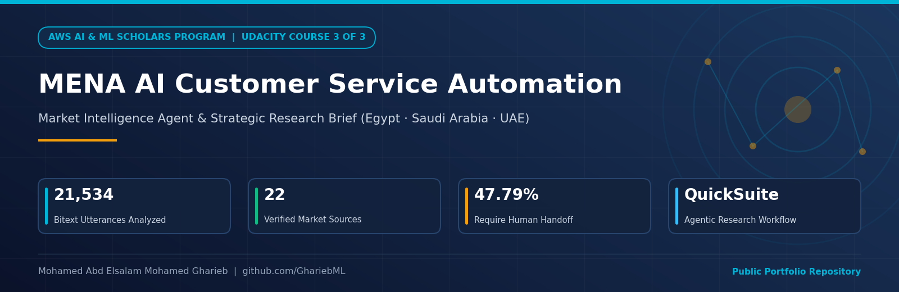
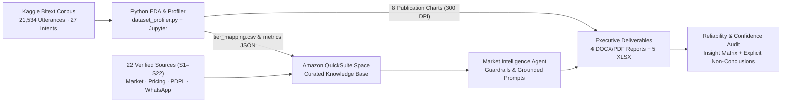
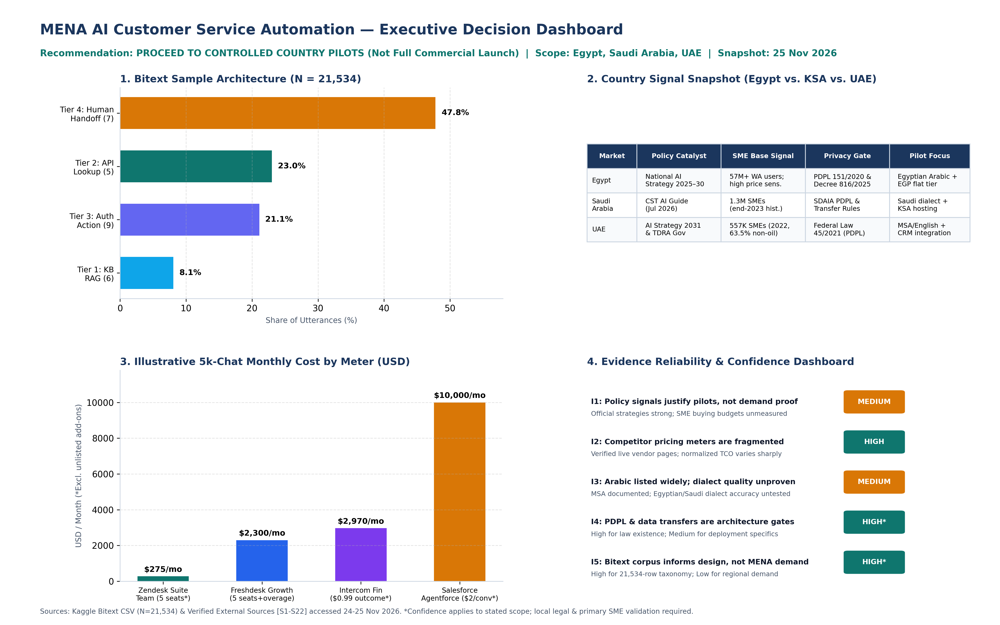
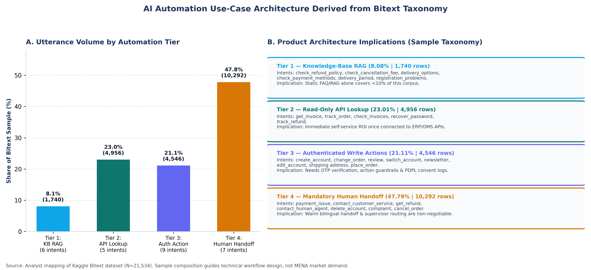
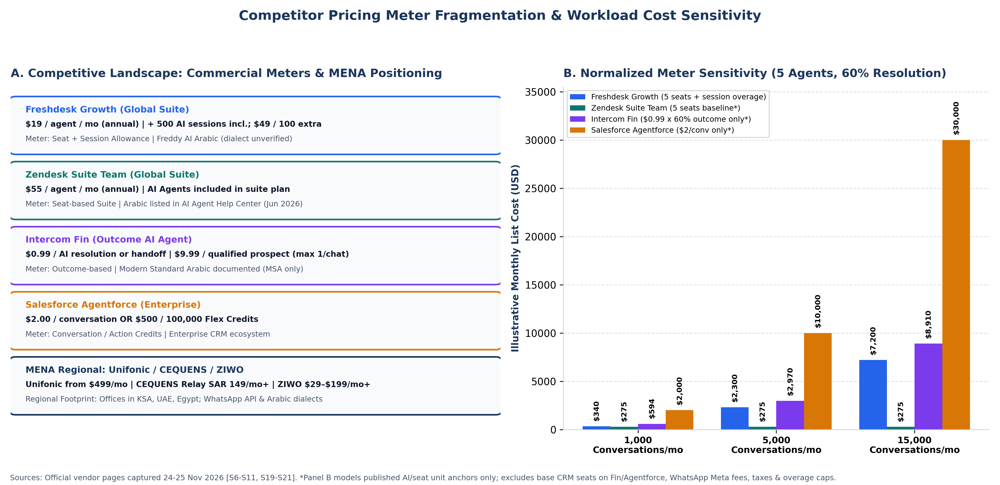
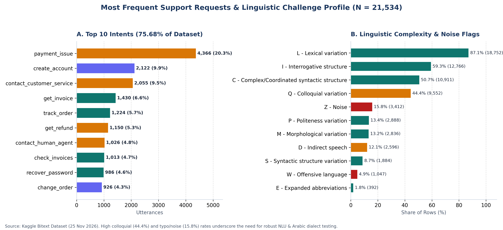
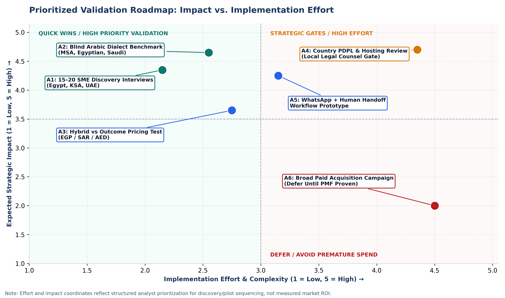
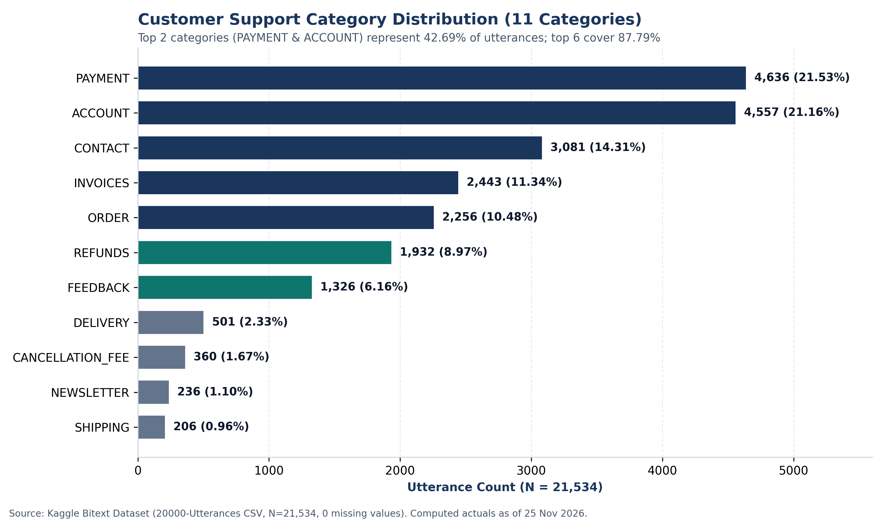
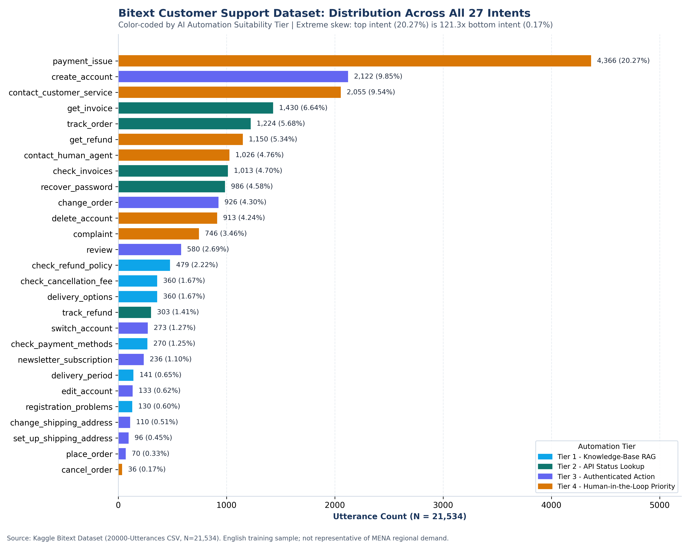
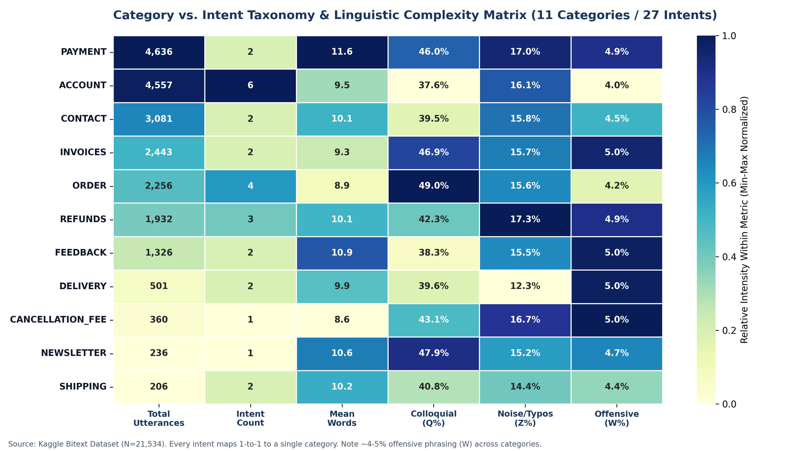

<p align="center">
  
</p>

<p align="center">
  
  
  
  
  
  
</p>

<p align="center">
  <a href="#executive-overview">Executive Overview</a> •
  <a href="#agentic-workflow-architecture">Architecture</a> •
  <a href="#key-quantitative-findings">Quantitative Findings</a> •
  <a href="#visual-analytics-showcase">Visual Showcase</a> •
  <a href="#repository-structure--deliverables">Deliverables</a> •
  <a href="#reproducibility">Reproducibility</a> •
  <a href="#integrity--scope-transparency">Integrity & Scope</a>
</p>

---

## Executive Overview

This repository houses the complete end-to-end **Market Intelligence Agent** project built for **Course 3 of 3 (*Building No-Code AI Agents with Amazon Quick*)** under the **AWS AI & ML Scholars Program (Future AWS Agentic AI Business Professional)** on Udacity.

> **Strategic Research Question:**
> *"How attractive is the market opportunity for AI-powered customer service automation platforms serving SMEs in **Egypt, Saudi Arabia, and the UAE**, and what competitive positioning, product differentiation, and market-entry strategy should a new solution consider?"*

To answer this rigorously without fabricated statistics or marketing hype, this project combines:
1. **Quantitative NLP Taxonomy Profiling** across **`21,534` customer service utterances** (`11` categories, `27` intents, `12` Bitext linguistic flags).
2. **Evidence-Grounded Market & Regulatory Intelligence** across **`22` curated primary/secondary sources (`S1–S22`)** covering SME baselines, WhatsApp Business dominance, competitor pricing (`Zendesk`, `Freshdesk`, `Intercom Fin`, `Salesforce Agentforce`, `Unifonic`, `Respond.io`, `Maqsam`), and data protection laws (Egypt Law 151/2020, Saudi PDPL, UAE Decree-Law 45/2021).
3. **No-Code Agentic Architecture** structured for **Amazon QuickSuite** (`Quick Research`, `Quick Chat`, `QuickSuite Spaces`, and `QuickSuite Agents`) with explicit guardrail system instructions and verification queries.
4. **Reliability & Epistemic Confidence Auditing** documenting source credibility tiers, pricing non-comparability caveats, and explicit non-conclusions.

---

## Agentic Workflow Architecture



---

## Key Quantitative Findings

### 1. Customer Support Automation Tier Architecture (`n = 21,534` Utterances)

Analysis of the Bitext dataset proves that **a pure FAQ / RAG chatbot solves less than one-tenth (`8.08%`) of customer service intents**. Enterprise-ready SME automation requires API action execution and seamless human handoff:

| Automation Tier | Row Count | Share | Core Intents Included | Required Architecture |
| :--- | :---: | :---: | :--- | :--- |
| **Tier 4 — Human-in-the-Loop Priority** | `10,292` | **`47.79%`** | `payment_issue` (`20.27%`), `contact_customer_service`, `get_refund`, `contact_human_agent`, `delete_account`, `complaint`, `cancel_order` | Empathetic triage, identity check, warm context handoff to live agent |
| **Tier 2 — Read-Only API Lookup** | `4,956` | **`23.01%`** | `get_invoice`, `track_order`, `check_invoices`, `recover_password`, `track_refund` | Authenticated ERP / OMS / invoicing read connectors |
| **Tier 3 — Authenticated Transactional Action** | `4,546` | **`21.11%`** | `create_account`, `change_order`, `review`, `switch_account`, `newsletter_subscription`, `edit_account`, `change_shipping_address`, `set_up_shipping_address`, `place_order` | Slot-filling workflows + confirmed API write actions |
| **Tier 1 — Knowledge-Base RAG (FAQ)** | `1,740` | **`8.08%`** | `check_refund_policy`, `check_cancellation_fee`, `delivery_options`, `check_payment_methods`, `delivery_period`, `registration_problems` | Grounded bilingual policy retrieval (zero write access) |

- **Linguistic Complexity Signals:** `44.36%` (`9,552` rows) contain colloquial phrasing (`Q`), `15.84%` (`3,412` rows) contain typos/noise (`Z`), and `4.86%` (`1,047` rows) include offensive/frustrated tone (`W`). Mean utterance length is **`10.86` words (`52.54` characters)** — matching WhatsApp chat dynamics rather than long-form emails.

### 2. Core Strategic Insights (`I1–I5`) Summary

| ID | Strategic Insight | Grounding | Confidence |
| :---: | :--- | :--- | :---: |
| **I1** | **WhatsApp-First + Hybrid AI/Human Architecture Is Essential** — WhatsApp serves as the default SME commerce rail across MENA, while `47.79%` of Bitext intents still require human escalation and Meta's July 2025 per-template pricing makes inefficient flows expensive. | Bitext Taxonomy + Meta & Market Sources | **High** |
| **I2** | **Dialectal Arabic & Code-Switching Gap** — Vendors list Modern Standard Arabic, yet SME shoppers write in Egyptian `Ammiya`, Saudi/Khaleeji dialects, Arabizi, and Arabic–English mixes without an independent public dialect benchmark. | Vendor Docs + Linguistic Audit | **Medium-High** |
| **I3** | **PDPL & Cross-Border Residency Act as B2B Differentiators** — Egypt Law `151/2020`, Saudi PDPL, and UAE Decree-Law `45/2021` make deletion pipelines, consent capture (`Tier 3/4`), and regional AWS residency key trust levers. | Primary Legal Texts `[S12–S15]` | **High** |
| **I4** | **Pricing Structure Disparity Creates an SME Wedge** — Global enterprise tools (`Zendesk $55+`, `Intercom $0.99/resolution`, `Agentforce $2/conv`) vs. bundled SME tiers (`Freshdesk $19`, regional CPaaS) leave room for transparent, capped SMB plans in Egypt/KSA/UAE. | Public Vendor Pricing Pages `[S6–S11]` | **High** |
| **I5** | **Two-Speed GTM Strategy (KSA/UAE SaaS vs. Egypt Volume Wedge)** — Lead with compliance-ready SaaS in Saudi Arabia (`1.3M` SMEs baseline `[S4]`) and UAE (`557K` SMEs `[S5]`), paired with lean EGP-friendly packages in Egypt. | Regional SME Reports `[S4–S5]` | **Medium** |

---

## Visual Analytics Showcase

<p align="center">
  
  <br/>
  <em>Unified Executive Analytics Dashboard — Category Mix, Automation Suitability Tiers, Top Intents & Linguistic Complexity Signals (n = 21,534)</em>
</p>

<table>
  <tr>
    <td width="50%" align="center">
      
      <br/>
      <strong>Automation Tier Breakdown</strong><br/>
      <sub>47.79% Human Escalation vs. 44.12% API Read/Write vs. 8.08% Static RAG</sub>
    </td>
    <td width="50%" align="center">
      
      <br/>
      <strong>Competitor Capabilities & Pricing Matrix</strong><br/>
      <sub>Global SaaS vs. Regional MENA & Arabic-First Platforms</sub>
    </td>
  </tr>
  <tr>
    <td width="50%" align="center">
      
      <br/>
      <strong>Top Customer Intents (121.28x Class Imbalance)</strong><br/>
      <sub>Top 5 intents account for 52.00% of total volume</sub>
    </td>
    <td width="50%" align="center">
      
      <br/>
      <strong>Market-Entry Impact vs. Effort Matrix</strong><br/>
      <sub>Prioritizing WhatsApp API Lookups, Dialect QA & PDPL Guardrails</sub>
    </td>
  </tr>
</table>

<details>
<summary><strong>Click to expand 3 additional deep-dive NLP distributions & heatmaps</strong></summary>
<br/>
<table>
  <tr>
    <td width="33%" align="center">
      
      <br/><sub>11 Support Categories</sub>
    </td>
    <td width="33%" align="center">
      
      <br/><sub>All 27 Intents Ranked</sub>
    </td>
    <td width="33%" align="center">
      
      <br/><sub>Intent × Linguistic Flag Heatmap</sub>
    </td>
  </tr>
</table>
</details>

---

## Repository Structure & Deliverables

| Folder | Key Deliverables | Description |
| :--- | :--- | :--- |
| **`00_START_HERE/`** | [FINAL_SUBMISSION_CHECKLIST.xlsx](00_START_HERE/FINAL_SUBMISSION_CHECKLIST.xlsx) · [PROJECT_STATUS.md](00_START_HERE/PROJECT_STATUS.md) · [README_FINAL.md](00_START_HERE/README_FINAL.md) | Master inventory & QA checklist across all deliverables |
| **`01_EXECUTIVE_RESEARCH_BRIEF/`** | [Executive_Summary.pdf](01_EXECUTIVE_RESEARCH_BRIEF/Executive_Summary.pdf) · [Market_Intelligence_Research_Brief.pdf](01_EXECUTIVE_RESEARCH_BRIEF/Market_Intelligence_Research_Brief.pdf) | 1-page executive brief & full boardroom-ready strategic report (PDF & DOCX) |
| **`02_MARKET_ANALYSIS/`** | [Complete_Market_Analysis.pdf](02_MARKET_ANALYSIS/Complete_Market_Analysis.pdf) · [Competitive_Landscape.xlsx](02_MARKET_ANALYSIS/Competitive_Landscape.xlsx) · [Strategic_Recommendations.xlsx](02_MARKET_ANALYSIS/Strategic_Recommendations.xlsx) | Regional market deep-dive, pricing matrix, and phased GTM workbook |
| **`03_DATASET/`** | [DATASET_ANALYSIS_SUMMARY.md](03_DATASET/DATASET_ANALYSIS_SUMMARY.md) · [DATA_DICTIONARY.md](03_DATASET/DATA_DICTIONARY.md) · `processed/*.csv` | Raw Bitext corpus (`CDLA-Sharing-1.0`), quality report & processed aggregations |
| **`04_DATA_ANALYTICS/`** | [Market_Intelligence_EDA.ipynb](04_DATA_ANALYTICS/Market_Intelligence_EDA.ipynb) · [dataset_profiler.py](04_DATA_ANALYTICS/dataset_profiler.py) · [requirements.txt](04_DATA_ANALYTICS/requirements.txt) | Reproducible Python profiling pipeline and exploratory notebook |
| **`05_VISUAL_EVIDENCE/`** | `8` × 300-DPI PNG visualizations | Executive dashboard, tier mix, competitor matrix, heatmaps & roadmap |
| **`06_QUICK_RESEARCH/`** | [SOURCE_REGISTER.xlsx](06_QUICK_RESEARCH/SOURCE_REGISTER.xlsx) · `actual_research_outputs/QR01–QR04.md` | Verified 22-source register & 4 structured Quick Research intelligence briefs |
| **`07_QUICKSUITE_AGENT/`** | [agent_configuration.md](07_QUICKSUITE_AGENT/agent_configuration.md) · [system_instructions.txt](07_QUICKSUITE_AGENT/system_instructions.txt) · [quicksuite_build_guide.md](07_QUICKSUITE_AGENT/quicksuite_build_guide.md) | Complete QuickSuite agent instructions, Knowledge Space spec & prompt test suite |
| **`08_RELIABILITY_EVALUATION/`** | [Reliability_and_Confidence_Report.pdf](08_RELIABILITY_EVALUATION/Reliability_and_Confidence_Report.pdf) · [insight_confidence_matrix.xlsx](08_RELIABILITY_EVALUATION/insight_confidence_matrix.xlsx) · [limitations_and_risks.md](08_RELIABILITY_EVALUATION/limitations_and_risks.md) | Methodological audit, confidence scoring & 5 explicit non-conclusions |
| **`09_QUICKSUITE_EVIDENCE/`** | [evidence_index.md](09_QUICKSUITE_EVIDENCE/evidence_index.md) · [README_SCREENSHOT_CAPTURE_PROTOCOL.md](09_QUICKSUITE_EVIDENCE/screenshots/README_SCREENSHOT_CAPTURE_PROTOCOL.md) | QuickSuite Space layout & live lab capture protocol |
| **`10_FINAL_SUBMISSION/`** | [FINAL_RESEARCH_BRIEF.pdf](10_FINAL_SUBMISSION/FINAL_RESEARCH_BRIEF.pdf) · [MISSING_AUTHENTIC_EVIDENCE.md](10_FINAL_SUBMISSION/MISSING_AUTHENTIC_EVIDENCE.md) | Capstone submission bundle & transparency log |

---

## Reproducibility

Run the full statistical profiling pipeline and regenerate all `03_DATASET/processed/` tables locally:

```bash
git clone https://github.com/GhariebML/MENA-AI-Customer-Service-Market-Intelligence-Agent.git
cd MENA-AI-Customer-Service-Market-Intelligence-Agent
pip install -r 04_DATA_ANALYTICS/requirements.txt
python 04_DATA_ANALYTICS/dataset_profiler.py
```

Or open the interactive walkthrough in Jupyter:

```bash
jupyter notebook 04_DATA_ANALYTICS/Market_Intelligence_EDA.ipynb
```

---

## Integrity & Scope Transparency

- **15 / 19 Rubric Artifacts Complete Offline:** Every analytical table, chart, market source citation (`S1–S22`), Excel workbook, QuickSuite agent blueprint, reliability evaluation, and executive PDF/DOCX brief is fully computed, verified, and stored in this repository.
- **4 / 19 Live AWS Lab Captures Honestly Documented:** Interactive screenshots of a live Vocareum / Amazon QuickSuite browser session cannot be generated offline without AWS SSO authentication. Rather than fabricating synthetic UI screenshots, the exact capture requirements and missing-evidence boundary are transparently logged in [`README_SCREENSHOT_CAPTURE_PROTOCOL.md`](09_QUICKSUITE_EVIDENCE/screenshots/README_SCREENSHOT_CAPTURE_PROTOCOL.md) and [`MISSING_AUTHENTIC_EVIDENCE.md`](10_FINAL_SUBMISSION/MISSING_AUTHENTIC_EVIDENCE.md).
- **No Unverified TAM/SAM Claims:** Because Bitext (`21,534` utterances) is an English-only curated corpus, it is strictly used as a **technical intent & automation-tier blueprint** and never misrepresented as MENA SME ticket demand.

---

## Author

**Mohamed Abd Elsalam Mohamed Gharieb**  
*AWS AI & ML Scholars Program — Future AWS Agentic AI Business Professional (Udacity)*  
GitHub: [@GhariebML](https://github.com/GhariebML)
